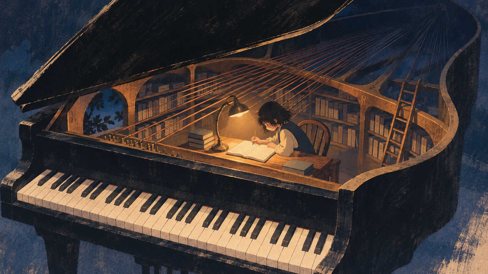

# 耳边自习室

## 使用

下载整个仓库并双击 [index.html](index.html) 即可离线使用。歌单可按曲名、风格和乐器搜索，筛选只影响页面显示，续播采用完整歌单顺序。专注模式收起歌单，按 Esc 返回。背景、环境声、音量和循环方式会与播放位置一起保存在浏览器。

## 巴萨诺瓦、凯尔特民谣与五拍马林巴

| 曲目 | 写法 | 封面 |
| --- | --- | --- |
| [天井里的半拍](media/study-bossa-long.mp3) | 巴萨诺瓦，尼龙弦切分与长笛答句 | [阳光天井](media/study-bossa.jpg) |
| [灯塔以北三英里](media/study-celtic-long.mp3) | 六八拍凯尔特民谣，哨笛、小提琴与竖琴 | [海岬灯塔](media/study-celtic.jpg) |
| [玻璃珠计数法](media/study-mallet-long.mp3) | 五拍极简音乐，马林巴与颤音琴 | [蓝色玻璃珠](media/study-mallet.jpg) |

每首约 51 分钟、六个段落。运行 `python render-encore.py <ffmpeg 的路径>` 会把三首编曲送入共享的 SoundFont 渲染流程。三张封面由内置 ImageGen 分别生成，提示依次为带陶土格栅和木椅的巴西天井、沿石墙小路延伸到白灯塔的冷绿海岬、深色石板上的五颗蓝色玻璃珠。

在独立克隆中，如需重新合成音频，将 [GeneralUser GS](https://github.com/mrbumpy409/GeneralUser-GS) 检出到 `reference/study-generaluser-gs`，把 [Tonejs Instruments](https://github.com/nbrosowsky/tonejs-instruments) 检出到 `reference/study-instruments`，再运行 `python -m pip install --target reference/study-python tinysoundfont==0.3.7`。已生成的网页和音频可直接播放。

## 钢琴独奏辑

双击 [index.html](index.html)，十九个长篇放在同一张自习歌单，合计约 16 小时 31 分钟。首次打开默认选中《放学铃响之前》，随后按卡片顺序续播。四首钢琴组曲约 3 小时 30 分钟，每首有八个可跳转乐章，并配一张独立照片。可用「背景」把任一照片固定下来，切歌时继续显示。同一浏览器重新打开时会恢复上次曲目、进度和背景，由你点播放再继续。浏览器禁用本地存储时仍可播放。

| 曲目 | 写法 |
| --- | --- |
| [页边的赋格](media/piano-margin-long.mp3) | 52:29 · 左右手先后模仿同一动机 |
| [电梯没有七楼](media/piano-elevator-long.mp3) | 52:01 · 三拍圆舞曲，右手用弱拍和停顿拉开乐句 |
| [第零号索引](media/piano-index-long.mp3) | 52:06 · 五拍按三加二分组，固定音型逐段移位 |
| [秒针在纸上走](media/piano-tick-long.mp3) | 52:56 · 自由速度的夜曲，旋律在上方、低音宽距分解 |

[render-piano.mjs](render-piano.mjs) 编排乐谱并通过不同力度、触键时间与释音混合实录钢琴采样，按八个乐章变奏和编排，再分批送入 FFmpeg 编码成长篇。原钢琴短版文件保留于本地。运行方法为 `node render-piano.mjs <ffmpeg.exe 的路径>`，需要工作区已下载的 `reference/study-instruments/samples/piano/`。音符录音源自 Versilian Studios 的 VSO2 钢琴，经 Nicholaus P. Brosowsky 的 Tonejs Instruments 整理。项目采样采用 CC BY 3.0，本文交付音频将其演奏、混合为原创曲目。 [采样来源](https://github.com/nbrosowsky/tonejs-instruments/blob/master/sample-source-info.txt) · [CC BY 3.0](https://creativecommons.org/licenses/by/3.0/)

## 番剧片头风

[《放学铃响之前》49:17](media/anime-opening-long.mp3) 以完整的约 85 秒片头曲开场。148 BPM，清音电吉他引出主歌，鼓组与弦乐在预副歌逐渐推进，约 0:45 进入第一个副歌。后续六章重编同一主题，包括清音、电贝斯与鼓、弦乐、原声吉他、钢琴和升调的乐队结尾。全曲纯器乐。

[夕阳里的学校天台](media/anime-opening.jpg)由内置 ImageGen 生成。绘图提示指定了从校舍顶层楼梯口望向空旷天台，铁栏、被风吹起的缎带、书包和晚霞积云。画面采用清晰动画线条，左边的前景阴影留给播放器叠字。

[render-opening.py](render-opening.py) 以 TinySoundFont 0.3.7 与 S. Christian Collins 的 GeneralUser GS 音色库生成乐队演奏，流式写入 FFmpeg。音色库在 `reference/study-generaluser-gs/`，Python 依赖通过 `python -m pip install --target reference/study-python tinysoundfont==0.3.7` 安装。运行 `python render-opening.py <ffmpeg.exe 的路径>` 生成长音轨与章节索引。 [GeneralUser GS](https://github.com/mrbumpy409/GeneralUser-GS) · [TinySoundFont](https://pypi.org/project/tinysoundfont/)

## 爵士、室内乐与柔和电子

| 曲目 | 时长与配器 | 封面 |
| --- | --- | --- |
| [两张票根之间](media/mix-jazz-long.mp3) | 51:35，摇摆钢琴三重奏与刷鼓 | [钢琴上的票根](media/mix-jazz.jpg) |
| [三封未寄出的信](media/mix-chamber-long.mp3) | 51:30，三拍室内乐，弦乐、双簧管与竖琴 | [封蜡信纸](media/mix-chamber.jpg) |
| [信号通过第九扇窗](media/mix-electronic-long.mp3) | 51:31，柔和电子节拍、合成低频与短音回声 | [蓝色的第九扇窗](media/mix-electronic.jpg) |

每首六章。运行 `python render-variety.py <ffmpeg.exe 的路径>`，用已有 TinySoundFont 和 GeneralUser GS 音色库渲染，输出 MP3 和章节索引。三张横幅由内置 ImageGen 分别生成，提示依次为暖光中琴盖上的两张旧票根、静物油画中的三封信与大提琴、蓝调时分的混凝土立面与九窗中唯一亮起的一扇。三张都可单独固定为播放背景。

## 动画风纯音乐

| 曲目 | 时长与配器 | 插画 |
| --- | --- | --- |
| [今天的社团延长十分钟](media/anime-club-long.mp3) | 50:47，拨弦和电钢琴 | [放学后的音乐室](media/anime-club.jpg) |
| [地图外的第十一站](media/anime-train-long.mp3) | 51:22，木管和拨弦 | [山谷慢车](media/anime-train.jpg) |
| [片尾以后还有一页](media/anime-ending-long.mp3) | 51:03，钢片琴和柔垫 | [蓝调时分的书桌](media/anime-ending.jpg) |

每首六章。曲目配置见 [anime-themes.js](anime-themes.js)，运行 `node render-anime.mjs <ffmpeg.exe 的路径>` 会复用长篇合成器，生成三份 MP3 和章节索引。

三张背景通过内置 ImageGen 各生成一张，统一采用横幅动画背景画法，左侧给播放器文字留出空间。绘图提示词分别指定了放学后空无一人的音乐室、夕阳穿过高窗照到木地板；清晨山谷河边的旧式绿白单节列车、层叠的梯田与轻雾；蓝调时分的窗边书桌、台灯下折角的笔记本和远处亮灯的屋顶。图内无需文字和人物。

## 原长歌单

原五个长篇与钢琴曲共用同一张歌单，可点选任一曲目开始听。五个主题各约 54 分钟，共 **4 小时 30 分 26 秒**，每个主题含六章。播放器默认按歌单循环，支持章间跳转和单曲循环。环境声默认关闭，雨声、海浪和风声可以独立调音量。整个目录可离线使用，移动时请保留 `media/`。

| 主题 | 长听版 |
| --- | --- |
| 雨落窗沿 | [53:34 · 毡音钢琴、雨后小夜曲](media/rain-long.mp3) |
| 午后靠窗 | [54:11 · 暖调电钢琴、轻切分](media/cafe-long.mp3) |
| 林间散步 | [54:22 · 尼龙弦、林间圆舞曲](media/forest-long.mp3) |
| 潮汐来信 | [54:14 · 慢速氛围和声](media/sea-long.mp3) |
| 星灯书桌 | [54:05 · 钢片琴与柔垫](media/night-long.mp3) |

MP3 可单独复制到手机或本地播放器。30 个章节各有曲式设置，文件内的相邻段落通过交叠余音过渡。

## 制作与复用

[themes.js](themes.js) 定义拍号、速度、和弦进行、分解和弦节奏和旋律动机。[render.mjs](render.mjs) 用叠加泛音、包络和立体声延迟合成音色，渲染时把尾音按循环长度折回开头。执行 `node render.mjs` 可重新生成 WAV。原始短版 MP3 可用 FFmpeg 的 `-af loudnorm=I=-21:TP=-3:LRA=8 -ar 32000 -codec:a libmp3lame -q:a 3` 参数从对应 WAV 编码，环境声直接用 WAV。

长听版由 [render-long.mjs](render-long.mjs) 生成。运行 `node render-long.mjs <ffmpeg.exe 的路径>`，合成器按章节改变速度、拍号、调性、旋律轮廓和配器，再以约三秒的交叠连接段落。PCM 分批送入 FFmpeg 做动态压缩和峰值限制，再编码为 64 kbps 立体声 MP3，不在磁盘写入整场 WAV。播放器使用同次渲染生成的 [long-tracks.js](long-tracks.js) 保存时长和章节跳转点。

本地参考保存在工作区 `reference/study-*`。借鉴 Noroi / Iwai 的乐谱、合成、混音分层，查阅 Tone.js 的音符与调度接口、Howler.js 的循环与音量控制，并考察 Tonejs Instruments 的采样方案。交付音频全部以本项目乐谱和合成器渲染，播放器使用浏览器原生音频。 [Noroi / Iwai](https://github.com/ChetasLua/noroi-iwai) · [Tone.js](https://github.com/Tonejs/Tone.js) · [Howler.js](https://github.com/goldfire/howler.js) · [Tonejs Instruments](https://github.com/nbrosowsky/tonejs-instruments)

场景照片来自 Unsplash，按主题顺序存为本地 JPEG。 [雨](https://images.unsplash.com/photo-1515694346937-94d85e41e6f0) · [咖啡馆](https://images.unsplash.com/photo-1501339847302-ac426a4a7cbb) · [树林](https://images.unsplash.com/photo-1441974231531-c6227db76b6e) · [海](https://images.unsplash.com/photo-1500375592092-40eb2168fd21) · [夜空](https://images.unsplash.com/photo-1419242902214-272b3f66ee7a)

钢琴组曲的四张封面同样来自 Unsplash，按曲名顺序存于 `media/piano-*.jpg`。 [书架](https://images.unsplash.com/photo-1507842217343-583bb7270b66) · [楼宇](https://images.unsplash.com/photo-1511818966892-d7d671e672a2) · [手稿](https://images.unsplash.com/photo-1455390582262-044cdead277a) · [沙漏](https://images.unsplash.com/photo-1501139083538-0139583c060f)
